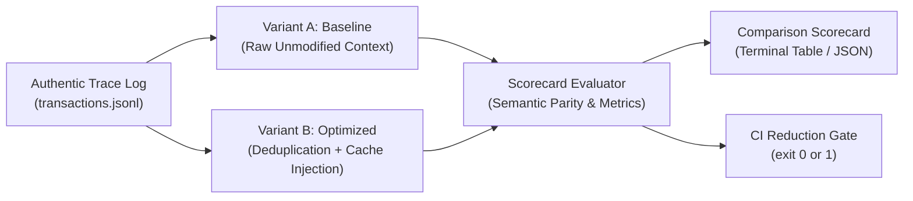

# Holon Coherence A/B Testing & Token Reduction Verification Guide

This guide details the methodology, command-line usage, scorecard metrics, and CI integration for the **Holon Coherence A/B Testing Suite** (`holon-coherence ab-test`).

---

## 🎯 Purpose & Philosophy

The Holon Coherence A/B testing suite provides **differential evaluation** between unmodified baseline LLM requests and coherence-optimized requests.

### Key Invariant: Zero Synthetic Data (Rule 10)

> [!IMPORTANT]
> Official benchmarks, efficacy evaluations, and reduction scorecards must derive **exclusively from authentic real-world data streams** (genuine sandbox task executions, recorded wire logs, or production payload traces). Synthetic, mock, or generated token loops are strictly prohibited for reduction claims.



---

## 📥 Collecting Authentic Trace Logs

Holon Coherence proxies LLM traffic transparently while optionally writing sanitized wire logs.

### Enabling Wire Logging

Set `ENABLE_WIRE_LOGGING=1` (enabled by default) when running the proxy or coding agents:

```bash
# Start proxy with wire logging enabled
ENABLE_WIRE_LOGGING=1 holon-coherence start -d

# Run coding agent through proxy
holon-coherence run-agent agy "Refactor authentication module"
```

Wire transaction logs are recorded under `~/.holon/wire_logs/` as individual turn JSON files or aggregated into `transactions.jsonl`. All sensitive credentials and API keys are automatically scrubbed prior to persistence.

---

## 🚀 Running A/B Differential Evaluations

Use the `holon-coherence ab-test` command to evaluate traces offline or validate proxy efficacy:

### 1. Basic Evaluation

```bash
holon-coherence ab-test -f ~/.holon/wire_logs/transactions.jsonl
```

### 2. Multi-Round Statistical Stability

To simulate multi-session drift or stress test determinism across repeated turns:

```bash
holon-coherence ab-test -f transactions.jsonl --rounds 5
```

### 3. Enforcing CI Reduction Thresholds

Ensure that context cleaning achieves at least a minimum token reduction (e.g., 15%):

```bash
holon-coherence ab-test -f transactions.jsonl --fail-under-reduction 15.0
```

If the measured token reduction is less than 15.0%, the command exits with code `1`.

### 4. Structured JSON Output for Automation

For machine consumption or ingestion into telemetry pipelines:

```bash
holon-coherence ab-test -f transactions.jsonl --json > scorecard.json
```

---

## 📊 Understanding the Comparison Scorecard

When executed without `--json`, `holon-coherence ab-test` outputs a formatted comparison table:

```text
====================================================================
               HOLON COHERENCE A/B BENCHMARK SCORECARD
         Variant A: Baseline (Control)  vs  Variant B: Optimized
====================================================================
  📊 Total Evaluated Turns:       12 across 1 round(s)
  📥 Baseline Input Tokens:       84,250
  ⚡ Optimized Input Tokens:      62,110
  🎯 Net Tokens Reduced:          22,140 (26.28% reduction)
  💾 Characters Saved:            88,560 (26.28%)
  🔧 Tool Calls Pruned / Omitted: 6
--------------------------------------------------------------------
  ⏱️  Avg TTFT:                   Baseline: 1420.5ms | Optimized: 1207.4ms
  ⚡ TTFT Delta:                  -213.1ms
  🔍 Semantic Parity Check:       ✅ PASSED (100% Structural Equivalence)
--------------------------------------------------------------------
  🎯 CI Reduction Gate:           ✅ PASSED (Observed: 26.28% | Required: >=15.00%)
====================================================================
```

### Scorecard Metric Definitions

| Metric                     | Description                                                                     |
| :------------------------- | :------------------------------------------------------------------------------ |
| **Total Evaluated Turns**  | Number of unique request/response turns evaluated across all rounds.            |
| **Baseline Input Tokens**  | Authentic prompt tokens submitted by the client before optimization.            |
| **Optimized Input Tokens** | Net prompt tokens submitted to upstream LLMs after deduplication and pruning.   |
| **Net Tokens Reduced**     | Total tokens saved (`Baseline - Optimized`) and percentage reduction.           |
| **Characters Saved**       | Raw payload string reduction in bytes/characters.                               |
| **Tool Calls Pruned**      | Number of redundant historical tool outputs (`view_file`, `cat`, etc.) omitted. |
| **Avg TTFT & Delta**       | Time To First Token difference resulting from smaller prefill context windows.  |
| **Semantic Parity Check**  | Verifies that message order, roles, and schema invariants remain 100% intact.   |
| **CI Reduction Gate**      | Evaluates whether `--fail-under-reduction` criteria was satisfied.              |

---

## 🛡️ Semantic Parity & Safety Guarantees

The A/B test suite verifies that optimizations **never compromise agent behavior or reasoning quality**:

1. **Structural Invariants**: Message arrays must maintain role sequences (`user`, `assistant`, `tool_result`).
2. **Current Turn Immunity**: Active and recent turns are **never** pruned or summarized; only older historical turns undergo deduplication.
3. **Deterministic Content Hashing**: Tool outputs are hashed via SHA-256. If a file changes between reads, the new output produces a distinct hash and is preserved in full.

If any turn suffers structural corruption, the evaluation reports `Semantic Parity Check: ❌ FAILED` and terminates with a non-zero exit code.

---

## 🤖 CI/CD Integration Example

To run regression checks on authentic traces during pull request workflows:

```yaml
name: Token Reduction Regression Suite
on: [push, pull_request]

jobs:
  ab-test:
    runs-on: ubuntu-latest
    steps:
      - uses: actions/checkout@v4
      - uses: astral-sh/setup-uv@v5
      - run: uv sync --group dev
      - name: Run A/B Verification Gate
        run: |
          uv run holon-coherence ab-test \
            --trace-file tests/fixtures/sample_trace.jsonl \
            --fail-under-reduction 15.0
```
