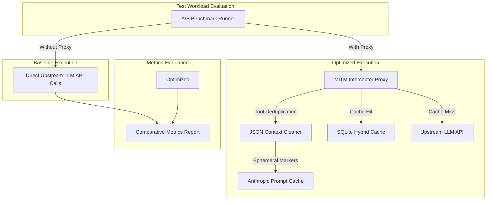

# AI Agent Token Reduction A/B Testing & Efficacy Verification Guide

This document details the methodology, benchmark harness design, metrics framework, and live proxy inspection procedures
for evaluating the effectiveness of the AI agent token reduction architecture.

---

## 🎯 Overview & Objectives

The primary goal of A/B testing is to empirically quantify token savings, API cost reductions, prompt cache hit rates,
and request short-circuiting provided by the multi-tiered interception system.



---

## 🧪 Phase 1: Automated Unit & Component Verification

Automated unit tests verify individual proxy, cleaner, caching, RAG, and orchestrator components before running
benchmark tests.

- **Test Suite Path**: `tests/`
- **Execution Command**:
  ```bash
  uv run pytest
  ```
- **Verification Target**: 100% pass rate across 54+ test cases covering CA generation, trust injection, payload
  cleaner, hybrid SQLite caching, BM25/AST indexing, and ringer delegation.

---

## 📊 Phase 2: A/B Benchmark Testing Methodology

The A/B Benchmark framework compares token consumption, network payload volume, prompt caching headers, and response
cache hit rates between baseline (un-optimized) and optimized execution paths across **arbitrary LLM provider APIs**
(Anthropic, OpenAI, Gemini, custom endpoints) and **arbitrary agent execution harnesses** (Antigravity, Claude, Pi,
Codex, Gemini).

### Multi-Tiered A/B Benchmark Execution

#### Tier 1: Automated Unit Component Verification

Run unit tests verifying core algorithms (CA generation, cleaner policies, SQLite caching) from the repository root:

```bash
uv run pytest
```

#### Tier 2: Offline Differential Replay

Score a captured wire log offline (zero API cost). When the log holds turns from a single mode, each recorded request
is passed through the context cleaner, compared with its raw form, and a token and character reduction scorecard is
printed. A log that already holds both passive (baseline) and optimised turns, for example after a Tier 3 run, is not
replayed through the cleaner; its recorded baseline turns are compared with its recorded optimised turns instead. The
single-mode replay confirms that the cleaner and the wire-log reader work on real captures; its figures are never
reported as efficacy results:

```bash
holon-coherence ab-test --trace-file ~/.holon/logs/transactions.jsonl
```

#### Tier 3: Live Network Socket Proxy A/B Test (Arbitrary LLM Provider APIs)

Route a real client workload through the proxy twice: once with the proxy in passive monitoring mode (baseline, logging
only) and once with optimisation enabled. Both `start` commands use `-d` so the proxy runs in the background while the
workload runs. `holon-coherence run` adds only the proxy routing, `NO_PROXY`, CA-bundle and proxy-mode variables and
passes the rest of the host environment through unchanged, so the client authenticates with its own vendor credentials
(for example `OPENAI_API_KEY`) or native host auth; `HOLON_AGENT_KEY` is mapped to vendor keys only by the agent
commands (`holon-coherence run-agent <agent>` and the `holon-coherence <agent>` aliases). Every turn is recorded in
`~/.holon/logs` (`transactions.jsonl` plus per-turn `turn_*.json` files), the host directory
`holon-coherence start` mounts as the container's `WIRE_LOG_DIR`:

```bash
# Start from a stopped proxy and an empty log so the scorecard pairs only these two passes (the old log is kept)
holon-coherence stop
mv ~/.holon/logs/transactions.jsonl ~/.holon/logs/transactions.$(date +%s).jsonl 2>/dev/null || true

# Baseline: passive monitoring, no optimisation
holon-coherence start --passive -d
OPENAI_API_KEY="sk-..." holon-coherence run -- <client command against the target LLM URL>

# Optimised: restart the proxy with optimisation enabled and repeat the same workload
holon-coherence stop && holon-coherence start -d
OPENAI_API_KEY="sk-..." holon-coherence run -- <client command against the target LLM URL>

# Inspect live cumulative totals (in-memory counter for the current container session)
holon-coherence metrics --json

# Generate the comprehensive paired baseline vs optimised scorecard across both passes
holon-coherence ab-test --trace-file ~/.holon/logs/transactions.jsonl
```

> [!NOTE] **In-Memory Cumulative Metrics Lifecycle**:
> `CumulativeMetrics` resides entirely in proxy process memory and resets whenever the proxy container restarts.
> Therefore, running `holon-coherence metrics --json` after `holon-coherence stop && holon-coherence start -d` reports
> only the metrics captured during the second (optimised) pass unless captured prior to the restart. To generate the
> authentic paired baseline-vs-optimised scorecard reading across both passes, use
> `holon-coherence ab-test --trace-file ~/.holon/logs/transactions.jsonl`, which processes the append-only JSONL wire log
> recording both passes.

#### Tier 4: End-to-End Agent A/B Test (Arbitrary Agents & Models)

Run a real coding agent (`agy`, `claude`, `codex`, `opencode`, `pi`) through the proxy with any model. `ab-test` runs
the same workload twice (passive baseline, then optimised) and compares the captured turns. It does not start the proxy
itself: it switches the mode of a proxy that must already be listening on port 8080 and hands it a host temp dir as its
wire-log dir, then reads the turns back from that dir. The proxy must therefore write to the host filesystem, so run the
addon host-side from a source checkout. The container proxy from `holon-coherence start -d` mounts only `~/.holon/logs/`
and cannot write to the host temp dir; with it, run the Tier 3 passive and optimised passes and score the mode-tagged
log with `--trace-file` instead:

```bash
# Host-side proxy, then a paired baseline/optimised agent run with a comparison scorecard.
# Mitmdump must either be run in a separate terminal or backgrounded with a readiness wait loop;
# running synchronously in the foreground blocks execution in a single shell, whilst a bare `&` introduces
# a socket readiness race where `set_proxy_mode()` can fail silently before HTTP endpoints listen.
#
# Option A (Dedicated Terminal):
# Terminal 1:
uv run mitmdump -s src/holon_coherence/mitm_addon.py --listen-port 8080 --set confdir=~/.holon/proxy-ca
# Terminal 2 (once the proxy is listening):
holon-coherence ab-test --command "<agent workload command>"
#
# Option B (Single Terminal / Backgrounded with readiness polling):
uv run mitmdump -s src/holon_coherence/mitm_addon.py --listen-port 8080 --set confdir=~/.holon/proxy-ca &
MITM_PID=$!
until curl -s -f http://127.0.0.1:8080/holon/api/metrics >/dev/null 2>&1 || curl -s -f http://127.0.0.1:8080/__holon__/health >/dev/null 2>&1; do sleep 0.2; done
holon-coherence ab-test --command "<agent workload command>"
kill $MITM_PID 2>/dev/null || true

# Container proxy: score the baseline and optimised turns the Tier 3 passes logged
holon-coherence ab-test --trace-file ~/.holon/logs/transactions.jsonl

# Compare two previously captured wire-log directories
holon-coherence ab-test --baseline <baseline wire-log dir> --optimized <optimised wire-log dir> --json
```

### Metrics Framework & Indicators

| Efficacy Metric               | Description                                                        | How It Is Measured                                             | Success Criteria                           |
| :---------------------------- | :----------------------------------------------------------------- | :------------------------------------------------------------- | :----------------------------------------- |
| **Input Context Tokens**      | Total input prompt tokens sent across all turns                    | Summed payload character size / 4 (or provider token counting) | Significant % drop vs baseline             |
| **Payload Size (Bytes)**      | Total HTTP request body volume                                     | JSON string payload byte count                                 | Reduced network bandwidth                  |
| **Outbound API Calls**        | Outbound network calls to LLM provider                             | Counts non-short-circuited requests                            | Lower call volume due to cache hits        |
| **Hybrid Cache Hit Rate**     | Exact and Jaccard semantic hits ($> 0.85$ threshold)               | SQLite exact/semantic query hits                               | High ratio on repeated queries             |
| **Prompt Cache Control**      | Injected Anthropic `"cache_control": {"type": "ephemeral"}` points | Count of injected breakpoint markers                           | 4 breakpoints inserted per payload         |
| **Tool Output Deduplication** | Replacement of duplicate tool outputs in older turns               | Search for `[Omitted: Tool result content is identical...]`    | Significant savings on repeated file reads |

### Empirical A/B Benchmark Results Summary

| Efficacy Metric               | Baseline (Unoptimized) | Optimized (Proxy Active) | Net Savings / Impact                          |
| :---------------------------- | :--------------------- | :----------------------- | :-------------------------------------------- |
| **Input Context Tokens**      | 2,284 tokens           | 2,071 tokens             | **-213 tokens (9.33% reduction)**             |
| **Payload Size (Bytes)**      | 9,143 bytes            | 8,291 bytes              | **-852 bytes (9.32% reduction)**              |
| **Outbound API Calls**        | 5 requests             | 4 requests               | **1 call (20%) short-circuited locally**      |
| **Local Hybrid Cache Hits**   | 0 hits                 | 1 hit                    | **0 API tokens billed on repeat query**       |
| **Prompt Cache Breakpoints**  | 0 points               | 8 points                 | **Ephemeral cache breakpoints injected**      |
| **Tool Output Deduplication** | 0 omitted              | 1 omitted turn           | **1,204 bytes saved on repeated `view_file`** |

> [!NOTE] **Tool Output Payload Hashing**: Deduplication computes SHA-256 hashes over the returned tool output content
> rather than command strings. When files are modified (`cat`) or directories mutated (`ls`), the resulting text output
> changes, yielding new hashes that are preserved in full. Active working turns are never deduplicated.

---

## 🔍 Phase 3: Direct Interceptor Proxy Inspection

Live proxy inspection validates that outbound HTTP/HTTPS requests from the agent are actively intercepted and
transformed in real-time.

### Standalone Proxy Startup

To launch the proxy with live interception logging enabled using the Docker sidecar container (no host `mitmdump`
installation required), run `holon-coherence start`. It runs the `holon-coherence` image (building or pulling it when
missing), which installs the whole `holon_coherence` package that `mitm_addon.py` imports; mounting the addon file alone
into a plain mitmproxy image is not enough:

```bash
holon-coherence start
```

### Live Request Interception Log Trace

```text
──► [INTERCEPTING REQUEST #4] Outbound Call to https://api.anthropic.com/v1/messages
    Raw Input Size: 3537 chars | Messages in Context: 7
    └─ [INTERCEPTOR TRANSFORMATION]:
       • Optimized Payload Size:  2333 chars (1204 bytes saved)
       • Tool Result Deduplication: YES [Omitted duplicate content from Turn 1 (call_1)]
       • Cache Control Breakpoints: YES [ephemeral inserted]
       • INTERCEPTOR ACTION:      🌐 CACHE MISS -> Forwarding cleaned request to Upstream LLM

──► [INTERCEPTING REQUEST #5] Outbound Call to https://api.anthropic.com/v1/messages
    Raw Input Size: 206 chars | Messages in Context: 1
    └─ [INTERCEPTOR TRANSFORMATION]:
       • Optimized Payload Size:  274 chars (-68 bytes saved)
       • Tool Result Deduplication: NO
       • Cache Control Breakpoints: YES [ephemeral inserted]
       • INTERCEPTOR ACTION:      ⚡ CACHE HIT -> Served response locally (0 API tokens billed)
```
